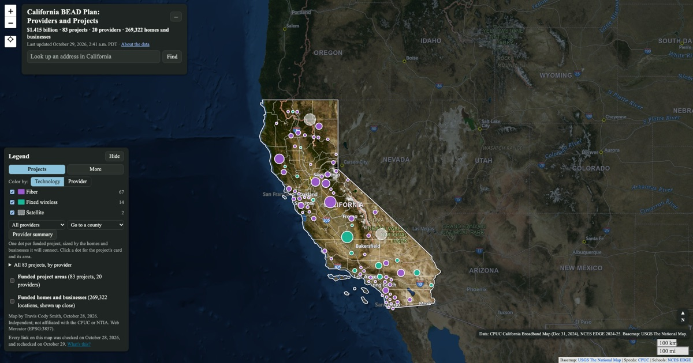

# California BEAD Plan: Providers and Projects

**Live map: https://traviscs.github.io/California-GigaBit-Schools-Draft/**

An interactive map of California's plan for the federal Broadband Equity, Access, and Deployment (BEAD) program. The plan puts **$1.415 billion** into **83 projects** from **20 providers** to connect **269,322 homes and businesses** that lack good internet service. The CPUC adopted it in Resolution T-17920, which was ratified on September 17, 2026, and NTIA approved it in July 2026.

By Travis Cody Smith. This is an independent map. It is not affiliated with or endorsed by the CPUC, NTIA or any provider shown.

## What the plan shows

These figures come from the CPUC project data. BEAD dollars are the grant only, without the providers' own match.

- **Fiber takes most of the money.** Fiber projects get 90% of BEAD dollars and reach 54% of locations. That works out to about $8,805 per location, against $1,198 for fixed wireless and $1,050 for satellite.
- **Satellite stretches furthest.** Two satellite projects (Amazon Kuiper and SpaceX) cover 27% of all locations (72,937) with 5% of the money.
- **A few providers get most of it.** Comcast and AT&T receive 52% of the money, and the top five providers receive 80%.
- **Costs vary widely.** BEAD support per location runs from $500 to $26,074 across projects, and the median project gets about $5,428.

On the map, these findings are under "What the plan shows" in the title card, next to a provider-by-provider chart.

## What you can do on the map

- **See every funded project.** Each project is a dot sized by the locations it will connect and colored by technology or by provider. Click a dot to see its card: provider, locations, BEAD dollars in total and per location, low-cost plan price, deadline, and its area on the map.
- **Look up an address**, with type-ahead suggestions. The map tells you whether the address falls in a funded project area and shows the nearest funded locations.
- **Filter** by provider or county, or browse all 83 projects grouped by provider.
- **Share a view.** Links such as `#p=<project id>`, `#prov=<provider>` and `#c=<county>` open the map on that project, provider or county.
- **Turn on context layers** under More: funded homes and businesses (all 269,322 points), the CPUC's low-income areas and tribal lands, public K-12 schools inside and outside the plan, and reported broadband speeds.
- **Use it on a phone.** The layout, cards and keyboard were tested at iPhone size.

## Data sources

| Source | Used for |
| --- | --- |
| CPUC, BEAD final proposal map service `BEAD_NTIA_Approved` (Projects and BSLs layers) | Project areas, providers, technology, dollars, locations, low-cost plan prices |
| CPUC, Resolution T-17920, Appendix B (funded projects, providers, community anchor institutions) | Project deadlines and the schools the plan names |
| CPUC, BEAD Public Dashboard layers `PAU_LIA` and `PAU_TRIBAL` | Low-income areas and tribal lands |
| CPUC, California Interactive Broadband Map, fixed consumer download maximum, end of 2024 | Reported speed shading |
| NCES, EDGE Public School Characteristics 2024-25 | School locations |
| U.S. Census Bureau, TIGERweb | State and county outlines |
| USGS, The National Map | Basemaps |
| Esri World Geocoding Service | Address lookup |

[metadata.md](metadata.md) has the full source list, fetch dates and processing steps.

## How it was built

The site is a single page built with [Leaflet](https://leafletjs.com/) 1.9.4. It has no build step and no server, and it is hosted on GitHub Pages. The data is prepared with small Python scripts in [`tools/`](tools):

| Script | What it does |
| --- | --- |
| `bead_areas.py` | Simplifies the 83 project areas from the CPUC service (about 400 m) and places each project's dot inside its largest piece |
| `project_names.py` | Gives each project a readable name from its counties, regions and main community. The official CPUC ID stays the ID. |
| `bead.py` | Matches mapped schools to the plan's anchor institution list and to the project areas |
| `context_layers.py` | Simplifies the low-income and tribal layers |
| `counties.py` | Builds county shapes and label points |
| `stamp.py` | Stamps each data file's content hash into `index.html`, so browsers never pair new code with stale data |

The add-ons [`lookup.js`](lookup.js), [`context.js`](context.js) and [`summary.js`](summary.js) load after the map and use a small hook object (`window.BEADMAP`). All numbers on the page are computed from the data files, not typed in by hand.

## Notes and limits

- Project shapes are simplified, so their edges are approximate. A project area covers the locations its project will connect, not every building inside it.
- Project names are written by this map. The CPUC identifies projects only by ID.
- Every link on the map was checked on October 28 and 29, 2026.

## AI use

The code and layout were written with Claude (Anthropic), which also gathered and processed the data from the sources above, under the author's direction and review.
